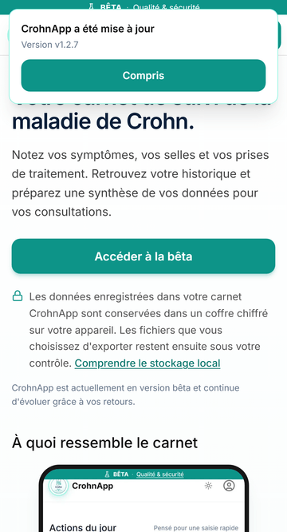

# Mettre à jour CrohnApp sur Android

CrohnApp peut désormais se mettre à jour sans être désinstallée. Chrome peut appliquer une version
silencieusement lorsque l'application est fermée ; dans ce cas, CrohnApp confirme la version active
à la prochaine ouverture.

1. Gardez une connexion Internet active et fermez complètement CrohnApp.
2. Fermez aussi les onglets `crohnapp.com` encore ouverts dans Chrome.
3. Rouvrez CrohnApp. Si « Mise à jour disponible » apparaît, touchez **Rafraîchir**.
4. CrohnApp confirme ensuite la version installée. Elle reste consultable dans **Profil**.

> Ne désinstallez jamais CrohnApp et n'effacez jamais ses données avant d'avoir créé et vérifié une
> sauvegarde. Le coffre médical est stocké uniquement sur l'appareil.

## Si CrohnApp est ouverte dans plusieurs fenêtres

Depuis la version 1.3.0, **Rafraîchir** ne recharge que la fenêtre où vous l'avez touché. Si
CrohnApp est ouverte dans d'autres fenêtres ou d'autres onglets, la mise à jour attend leur
fermeture et le message « Fermez les autres fenêtres de CrohnApp, puis réessayez » s'affiche. Ces
fenêtres ne sont jamais rechargées d'office : ce que vous y avez saisi reste en place. Enregistrez
vos saisies, fermez les autres fenêtres, puis touchez à nouveau **Rafraîchir**.

## Première ouverture de la version 1.3.0

À la première ouverture, CrohnApp prépare le stockage de vos carnets sur l'appareil, sans rien
recopier ni effacer. Si une fenêtre d'une version précédente est encore ouverte, l'écran « Fermez
les autres fenêtres de CrohnApp » s'affiche et attend : fermez les autres onglets et l'application
installée, la préparation se termine seule. N'effacez jamais les données du site pour accélérer
cette étape.

Après cette préparation, une ancienne fenêtre restée ouverte peut afficher une erreur en essayant
d'ouvrir votre carnet. Fermez-la : votre carnet s'ouvre normalement dans la nouvelle version, avec
le même mot de passe.

## Si un carnet demande une vérification

Si l'avis « Certains carnets à vérifier » s'affiche (« Certains carnets demandent une
vérification » en version 1.3.0), vos autres carnets restent accessibles et rien n'a été effacé.
Conservez ce navigateur et vos sauvegardes chiffrées, et n'effacez pas les données du site. La
[question dédiée de la FAQ](../FAQ.md#pourquoi-certains-carnets-demandent-ils-une-vérification-)
explique la situation et comment la signaler.

Les installations très anciennes peuvent avoir été créées avant la correction du mécanisme de mise
à jour. Si l'application reste bloquée, créez d'abord les sauvegardes clinique et photos chiffrées,
conservez leurs mots de passe séparément, puis contactez le projet avant toute réinstallation.
